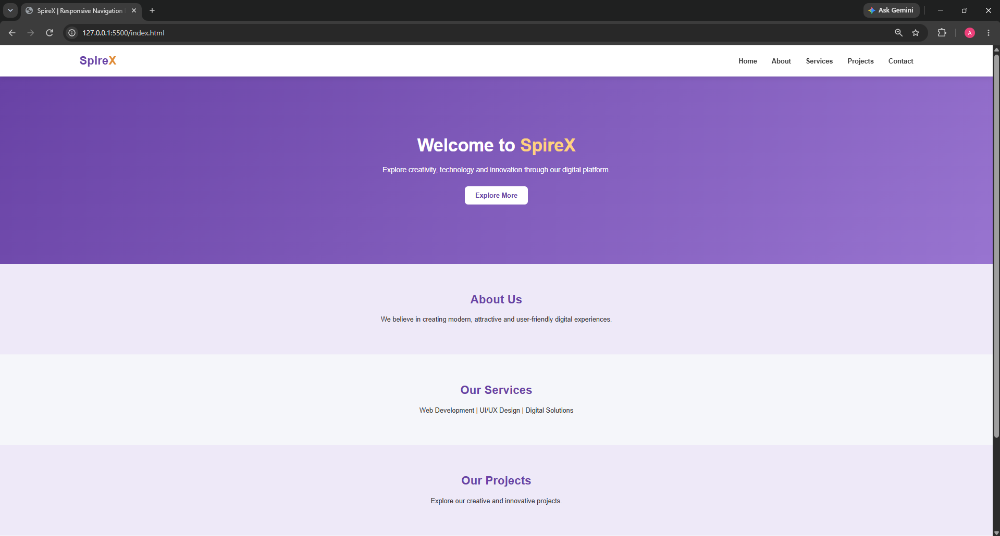
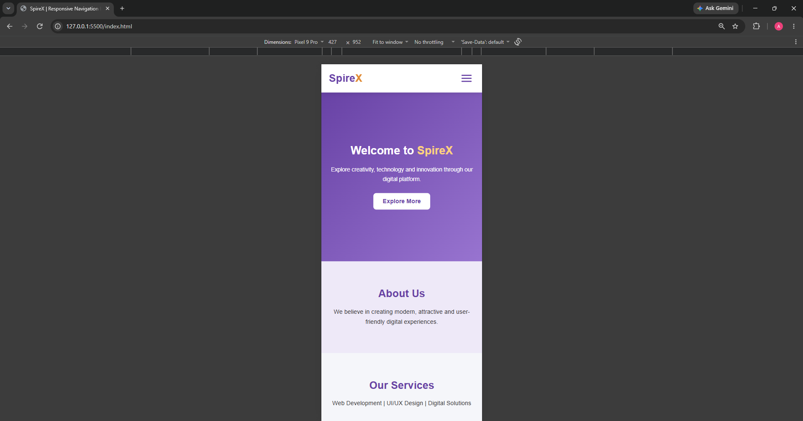

# Responsive Navigation Bar With Mobile Menu

## About the Project

A responsive navigation bar developed using HTML, CSS, and JavaScript. It adapts smoothly to desktop and mobile screens with an interactive hamburger menu.

## Features

- Responsive navigation bar
- Desktop horizontal navigation links
- Mobile hamburger menu
- Toggle menu functionality
- Animated hamburger icon
- Smooth scrolling navigation
- Menu closes after selecting a link
- Mobile-friendly design

## Technologies Used

- HTML5
- CSS3
- JavaScript


## Output Screenshots

### Desktop View



### Mobile View




## Project Structure

```text
Responsive-Navbar/
│
├── index.html
├── style.css
├── script.js
├── README.md
│
└── screenshots/
    ├── desktop-view.png
    └── mobile-view.png
```

## How to Run

1. Download or clone the repository.
2. Open the project folder in VS Code.
3. Open index.html using Live Server.
4. Resize the browser to test mobile responsiveness.
5. Click the hamburger menu to explore navigation.

## Developer

Aashlesha Vijay Sawane

BE Computer Science & Design Engineering

## Contact

- Email: aashleshasawane1@gmail.com
- GitHub: https://github.com/aashleshagit
- LinkedIn: https://www.linkedin.com/in/aashlesha-sawane-907aa8319/
